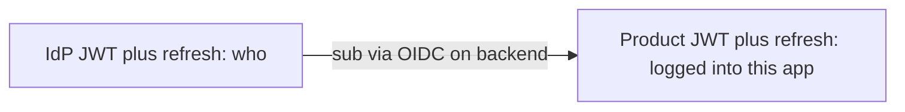
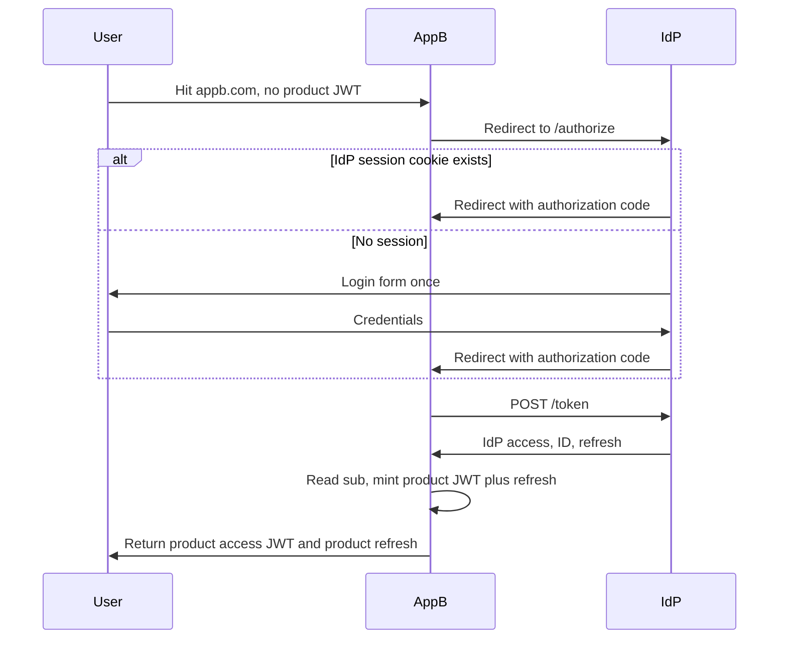

# Architecture

One IdP, many products, two token layers.

The IdP host (for example `auth.company.com`) holds the only login cookie. That cookie is an IdP **session**, used only to decide whether `/authorize` can issue a code without a prompt. It is not a credential for product APIs.

Products (`appa.com`, `appb.com`) are confidential OAuth clients. After `/token`, they read `sub` and mint product-local tokens.

## Why the split

- The IdP never becomes the bottleneck for “can they do this here?”
- Each product’s role model can evolve independently.
- IdP tokens stay small (identity claims only).
- The browser implements one refresh protocol: the product’s. It does not speak OIDC refresh.
- Same SSO pattern Google / Microsoft / Atlassian / Slack use across domains.

OPA, entitlements, and billing stay inside the product that owns the resource. Never on the IdP token.

## Silent SSO

Cookies are host-scoped. Product A and product B never see the IdP cookie. They redirect the browser to the IdP. If the session exists, the user returns with a code and never sees a login form. Each product then issues **its own** JWTs (different issuer and keys).

## Independent clocks

| Event | What happens |
| --- | --- |
| Product access JWT expired, product refresh valid | Product `/refresh`. IdP not involved. |
| Product refresh dead | Restart `/authorize`. Silent if IdP session still valid. |
| IdP access JWT expired, product JWT still valid | User keeps using the product. Backend refreshes IdP only if it still needs IdP tokens. |
| IdP refresh dead, product JWT still valid | This product keeps working until **its** refresh dies. |
| Stolen product refresh reused | That product revokes its own family. Other products untouched. |
| Stolen IdP refresh reused | That client's IdP family is revoked. Product JWTs already minted keep working until they expire. |

## Request path inside this repo

`GET /authorize` validates `client_id` and `redirect_uri` **before** it is willing to 302 anywhere. Failures before that render HTML on the IdP. After that, OAuth errors go to the (now trusted) redirect URI.

If a login is needed, `/authorize` 302s to `/login?next=<signed original query>`. On success, `/login` 303s back to `/authorize?...` which re-validates everything from scratch. There is no “pending auth request” table.

`POST /token` authenticates the client (Basic or post), then either consumes a code (`SELECT FOR UPDATE`, PKCE, exact redirect) or rotates a refresh (reuse ⇒ revoke family).

One function mints every IdP JWT and refuses unknown claims.

## Signing keys

RSA-2048, RS256. Private JWK is encrypted at rest with a key derived from `KEY_ENCRYPTION_KEY`. `/admin/keys/rotate` marks the current key `retiring` until `KEY_RETIRE_SECONDS` and inserts a new `active` key. JWKS continues to serve retiring keys so in-flight tokens verify. In-process cache TTL is `KEY_CACHE_SECONDS` (multi-instance lag is that long).

## Demo products

`demo/product.py` is the reference relying party, run twice (`PRODUCT_NAME=a|b`) to prove silent SSO. In-memory product refresh store — not a blueprint for production product DBs.
