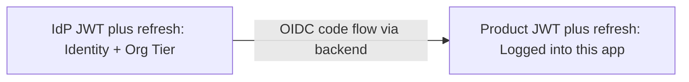
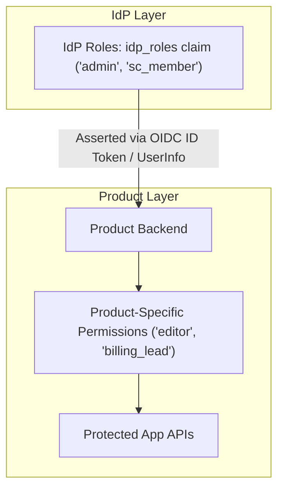
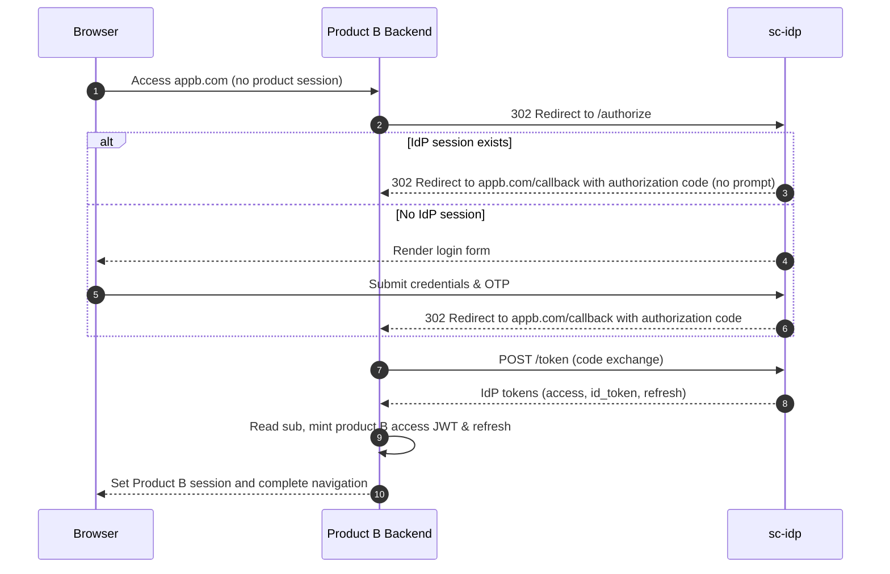
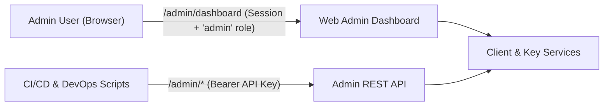

# System Architecture

Related docs: [Product Integration](integrating-a-product.md) · [IdP Technical Reference](idp-reference.md) · [Authentication & User Flows](flows.md) · [Security](security.md) · [Operations](operations.md)

One IdP, many products, two token layers.

The IdP host (e.g. `auth.company.com`) holds the primary login cookie. That cookie is an IdP **session**, used solely to determine whether `/authorize` can issue an authorization code without prompting the human. It is not an authorization credential for product APIs.

Products (`appa.com`, `appb.com`) are confidential OAuth clients. After exchanging an authorization code at `/token`, they verify identity claims, read `sub`, and mint product-local tokens.

---

## 1. Why the Split

- **No central authorization bottleneck**: Products validate authorization decisions locally; the IdP never sits on the hot path of application API authorization.
- **Independent role evolution**: Each product designs its own permission matrix, tenant boundaries, and policy engines without touching the IdP schema.
- **Clean identity boundary**: IdP tokens carry identity (`sub`, `email`, `profile`, `idp_roles`). Entitlements and billing stay inside the respective applications.
- **Isolated refresh protocols**: Frontend clients speak only their product backend's refresh protocol; they never handle IdP refresh tokens.
- **Battle-tested SSO**: Follows the federated architecture proven by Google, Microsoft, and Atlassian across multiple web domains.

---

## 2. Two-Tier Role Architecture

1. **IdP Roles (`idp_roles`)**: Assert platform-wide identity claims, such as staff status (`sc_member`) or central administration privileges (`admin`).
2. **Product Permissions**: Domain-specific roles (e.g., repository permissions, project roles, subscription plans) are managed and evaluated exclusively within each product backend.

---

## 3. Silent SSO Across Products

Because cookies are host-scoped, Product A and Product B cannot read the IdP session cookie. When a user navigates between products, SSO is achieved via top-level browser redirects.

---

## 4. Independent Token Clocks

| Event | System Behavior |
| --- | --- |
| **Product access JWT expired, product refresh valid** | Frontend calls Product `/refresh`. IdP is completely bypassed. |
| **Product refresh token expired or revoked** | Product redirects browser to IdP `/authorize`. If the IdP session is valid, SSO is instant and silent. |
| **IdP access JWT expired, product JWT valid** | Product continues operating normally. Backend refreshes IdP token only if it needs fresh UserInfo claims. |
| **IdP refresh dead, product JWT valid** | Product continues operating normally until **its own** refresh expires. |
| **Compromised product refresh token reused** | That product revokes its own refresh family. All other products remain unaffected. |
| **Compromised IdP refresh token reused** | IdP revokes that client's refresh family. Previously issued product JWTs continue until normal expiration. |

---

## 5. Administrative Surface Architecture

`sc-idp` separates administrative concerns into two operational channels:

- **Web Admin Dashboard (`/admin/dashboard`)**: Session-authenticated interface for managing OAuth clients, secret rotation, and status toggles. Access requires the `admin` role in `user_idp_roles`.
- **Admin REST API**: Headless endpoints for automated deployment pipelines authenticated via `Authorization: Bearer <IDP_ADMIN_API_KEY>`.
