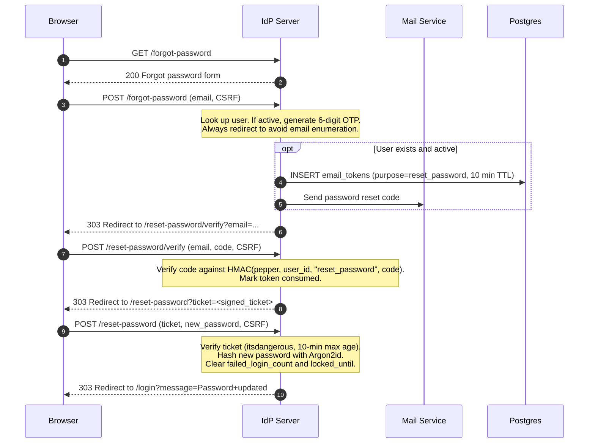
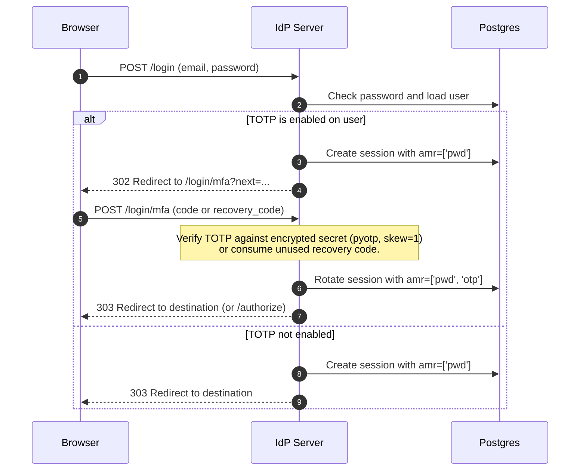

# Authentication & User Flows

Related docs: [Product Integration](integrating-a-product.md) · [IdP Technical Reference](idp-reference.md) · [Admin Guide](admin-guide.md) · [Security](security.md) · [Operations](operations.md)

This document details every human and protocol lifecycle flow implemented by `sc-idp`: registration with OTP verification, password reset with OTP, authorization with cancellation, multi-factor authentication (TOTP), and browser session lifecycle (silent SSO).

---

## 1. Registration & Email Verification (6-digit OTP)

Registration collects name and credentials, persists the account in an unverified state, applies preassigned roles, and emails a 6-digit numeric one-time password (OTP).

```mermaid
sequenceDiagram
  autonumber
  participant User as Browser
  participant IdP as IdP Server
  participant Mail as Mail Service / Console
  participant DB as Postgres

  User->>IdP: GET /register
  IdP-->>User: 200 Registration form (first_name, last_name, email, password, CSRF)
  User->>IdP: POST /register
  Note over IdP: Validate CSRF, rate limit (5/min per IP), check email uniqueness.<br/>Hash password with Argon2id.<br/>Apply preassigned roles.<br/>Generate 6-digit numeric OTP.
  IdP->>DB: INSERT users (email_verified=false), email_tokens (purpose=verify_email)
  IdP->>Mail: Send 6-digit OTP email (expires in 10 minutes)
  IdP-->>User: 303 Redirect to /verify-email?email=...
  User->>IdP: POST /verify-email (email, code, CSRF)
  alt Code matches and not expired
    IdP->>DB: UPDATE users SET email_verified=true; consume token
    IdP->>DB: INSERT auth_sessions (amr=['pwd'])
    IdP-->>User: 303 Redirect to destination (or /authorize if ?next= present) with idp_session cookie
  else Invalid code or expired
    IdP-->>User: 400 Verify OTP form with error message
  end
```

### Security & Rate Controls
- **Rate limiting**: Registration is throttled to 5 requests per minute per IP.
- **Verification attempts**: Verification attempts are throttled to 5 per 10-minute window per user (`otp_attempt:{user_id}`).
- **Resend cooldown & countdown**: Enforces a 30-second cooldown (`OTP_RESEND_COOLDOWN`) between OTP requests. The frontend resend button displays a live ticking countdown (`Resend code in 30s` -> `Resend code`); early attempts return HTTP 429.
- **Resend limit**: Resending OTP is limited to 3 attempts per 10 minutes (`otp_resend:{user_id}`).
- **Auto-login**: Successfully verifying the code mints an active browser session immediately without requiring a second login.

---

## 2. Password Reset (2-Step OTP)

Password reset is a two-step flow: requesting a 6-digit OTP via email, followed by setting a new password using a signed ticket.



### Security Notes
- **User enumeration protection**: Submitting `/forgot-password` unconditionally redirects to `/reset-password/verify`. An attacker cannot deduce user existence from the HTTP response.
- **Resend cooldown & countdown**: Like email verification, resends on `/reset-password/resend` require waiting 30 seconds (`OTP_RESEND_COOLDOWN`) with live countdown feedback on the button and backend 429 throttling.
- **Ticket signature**: The intermediate ticket between OTP verification and password entry is an `itsdangerous` timestamp-signed token scoped to `pwd_reset_ticket` with a strict 10-minute expiration.

---

## 3. OAuth Authorize, Account Confirmation & Cancellation

Relying parties initiate the authorization code flow by redirecting the user to `GET /authorize`.

```mermaid
sequenceDiagram
  autonumber
  participant User as Browser
  participant RP as Product Backend
  participant IdP as IdP Server

  RP->>User: 302 to IdP /authorize?client_id=...&redirect_uri=...&scope=...&code_challenge=...&state=...
  User->>IdP: GET /authorize
  Note over IdP: 1. Validate client_id & redirect_uri strictly.<br/>2. If invalid client/URI -> IdP error page (no 302).<br/>3. Check idp_session cookie.
  alt User not authenticated
    IdP-->>User: 302 Redirect to /login?next=<signed_authorize_query>
    User->>IdP: Login / Register / MFA
    IdP-->>User: 303 Redirect back to /authorize?...&confirmed=<ticket>
  else Active session exists
    opt Unconfirmed and prompt != none
      IdP-->>User: 200 Account Selection Screen (Choose an Account)
      alt User clicks active account card
        User->>IdP: POST /authorize/confirm (csrf, next)
      else User clicks "Use a different account"
        User->>IdP: GET /login?next=<next>&switch_account=1
        User->>IdP: POST /login (credentials for User B)
        Note over IdP: Cookie switched to User B; User A session in DB is NOT revoked.<br/>Mints signed confirmed ticket.
        IdP-->>User: 303 Redirect to /authorize?...&confirmed=<ticket>
      else User clicks "Cancel"
        User->>IdP: GET /cancel?next=<signed_authorize_query>
        IdP-->>User: 302 Redirect to RP redirect_uri?error=access_denied&state=...
      end
    end
  end
  alt Third-party client or prompt=consent
    IdP-->>User: 200 Consent screen (Allow / Cancel)
    alt User clicks Cancel
      User->>IdP: GET /cancel?next=<signed_authorize_query>
      IdP-->>User: 302 Redirect to RP redirect_uri?error=access_denied&state=...
    else User clicks Allow
      User->>IdP: POST /consent (decision=allow)
    end
  end
  IdP-->>User: 302 Redirect to RP redirect_uri?code=...&state=...
```

### Account Confirmation & Seamless Switching
When an active browser session exists on `/authorize`, `sc-idp` displays a dedicated account selection screen (`account_confirm.html`) before issuing tokens:
- **Interactive Account Card**: Displays an avatar initial, user's full name, and email address in a high-contrast card with hover elevation. Clicking the card immediately selects the active account and submits `POST /authorize/confirm`.
- **Use a Different Account**: Navigates to `/login?next={next}&switch_account=1`. The login page renders with a contextual switch prompt without auto-redirecting. When signing into the new account:
  - The browser session cookie (`idp_session`) is updated to the new user.
  - The previous user's session record in `auth_sessions` is **not revoked** (retaining active sessions across other devices and client apps).
  - A signed `confirmed` ticket is appended to the redirect back to `/authorize`, ensuring the newly authenticated account seamlessly proceeds without re-prompting.
- **Silent SSO (`prompt=none`)**: Requests passing `prompt=none` bypass the account chooser entirely, enabling background token renewal without human interaction.

### Cancellation Endpoint (`/cancel`)
Every IdP authentication page (account selection, login, registration, forgot-password, reset-password, and consent) includes a **Cancel** link when an authorization query is in progress.
- The signed `next` parameter is unpacked and validated.
- If valid and the client's `redirect_uri` matches, the browser is redirected to `{redirect_uri}?error=access_denied&state={state}`.
- If invalid or expired, the user is safely redirected to the IdP home page (`/`).

---

## 4. Multi-Factor Authentication (TOTP Step-Up)

Users can enable standard RFC 6238 TOTP authenticators from `/account`.



### Recovery Codes
- When enabling TOTP, 10 single-use recovery codes are generated and shown once.
- Stored as HMAC(pepper, code).
- Submitting a recovery code consumes the row and satisfies the `otp` step-up.

---

## 5. Silent SSO & Session Lifecycle

The browser session cookie (`idp_session`) enables Single Sign-On across multiple first-party products without prompting the user repeatedly.

| Parameter | Configuration | Default | Purpose |
| --- | --- | --- | --- |
| Cookie Name | `COOKIE_NAME` | `idp_session` | Host-scoped session credential |
| Flags | `HttpOnly`, `SameSite=Lax`, `Secure` | `Secure` in production | Blocks XSS access, allows top-level redirects |
| Idle Timeout | `SESSION_IDLE_TTL` | 12 hours (`43200s`) | Sliding window refreshed on active access |
| Absolute Timeout | `SESSION_ABSOLUTE_TTL` | 7 days (`604800s`) | Hard cap on continuous session lifetime |

### Session Fixation Defense & Account Switching
- **Same-User Re-authentication**: On every password re-verification, MFA step-up, and logout for the current user, the previous session row is revoked and a completely new random session token is minted.
- **Account Switching (Approach B)**: When switching to a different user via `/login?switch_account=1`, the browser cookie is pointed to the new user's newly minted session, but the previous user's session in `auth_sessions` is **not revoked**. This ensures existing tokens, refresh cycles, and sessions on other clients and devices remain active without disruption.
