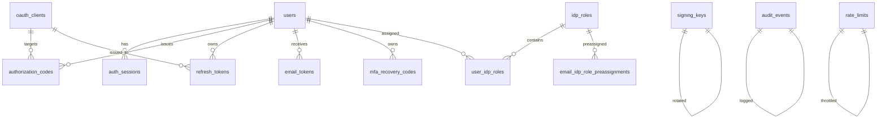

# IdP Technical Reference

This document covers the architectural theory, design decisions, and system implementation of `sc-idp`. Product integration contracts are in [integrating-a-product.md](integrating-a-product.md), user authentication flows are detailed in [flows.md](flows.md), administrative operations are in [admin-guide.md](admin-guide.md), security guarantees in [security.md](security.md), and environment runbooks in [operations.md](operations.md).

`sc-idp` is a **central OpenID Connect authorization server**. It verifies **who the user is** and asserts platform membership. Products determine **what the user can do** inside their domains.

---

## 1. Authentication vs Authorization

- **Authentication (AuthN)**: Validates identity, credentials, MFA, and organization membership.
- **Authorization (AuthZ)**: Decides whether an identity has permission to perform an action on a specific resource.

`sc-idp` enforces this separation cleanly:
1. `sub` (the user UUID) is the primary join key across all products.
2. The `idp_roles` claim provides platform-level membership (`admin`, `sc_member`) for high-level governance and staff access.
3. Application-specific roles, permissions, workspaces, and entitlements live entirely inside each product.

---

## 2. OAuth 2.0 & OpenID Connect Foundation

`sc-idp` strictly adheres to modern, security-hardened OIDC standards:
- **Confidential Clients Only**: All clients have a server-side backend capable of protecting `client_secret`. Public clients (pure SPAs / mobile apps without backends) are prohibited from directly exchanging codes.
- **Mandatory PKCE (RFC 7636)**: `code_challenge_method=S256` is enforced on every authorization code request. `plain` PKCE is rejected.
- **Strict Response Types & Grants**: Advertises and accepts only `response_type=code` with grants `authorization_code` and `refresh_token`. Implicit and hybrid flows are omitted to prevent token leakage in browser history and referer headers.
- **Metadata Aliases**: Discovery is accessible at standard `/.well-known/openid-configuration` as well as RFC 8414 `/.well-known/oauth-authorization-server`. Public keys are at `/.well-known/jwks.json` and `/.well-known/jwks`.

---

## 3. HTTP Surface

| Method | Path | Purpose |
| --- | --- | --- |
| `GET` | `/.well-known/openid-configuration` | OpenID Connect discovery metadata |
| `GET` | `/.well-known/oauth-authorization-server` | RFC 8414 OAuth authorization server metadata |
| `GET` | `/.well-known/jwks.json`, `/.well-known/jwks` | Public RSA signing keys (includes retiring keys) |
| `GET` | `/authorize` | Starts login/SSO; verifies client and exact redirect URI before any 302 |
| `GET` | `/cancel` | Cancels authorization flow; redirects to client `redirect_uri` with `error=access_denied` |
| `POST` | `/consent` | Third-party consent screen submission (Allow / Deny) |
| `POST` | `/token` | Exchanges authorization code or rotates refresh token |
| `GET` | `/userinfo` | Identity claims endpoint for IdP access tokens |
| `GET` | `/logout` | RP-initiated logout; clears browser session cookie |
| `GET` / `POST` | `/register` | Account registration; requires first name, last name, email, password |
| `GET` / `POST` | `/verify-email`, `/verify-email/resend` | 6-digit numeric OTP email verification |
| `GET` / `POST` | `/login` | Password authentication with lockout and dummy timing protection |
| `GET` / `POST` | `/login/mfa` | TOTP step-up authentication during login |
| `GET` / `POST` | `/forgot-password` | Requests 6-digit password reset OTP |
| `GET` / `POST` | `/reset-password/verify`, `/reset-password/resend` | Verifies reset OTP and issues signed 10-minute reset ticket |
| `GET` / `POST` | `/reset-password` | Sets new password using signed ticket |
| `GET` / `POST` | `/account` | User profile, password update, and TOTP setup/enable/disable |
| `GET` | `/admin/dashboard` | Web Admin Dashboard (requires session + `admin` role) |
| `POST` | `/admin/dashboard/clients` | Creates client via dashboard |
| `POST` | `/admin/dashboard/clients/{id}/rotate-secret` | Rotates client secret via dashboard |
| `POST` | `/admin/dashboard/clients/{id}/toggle-status` | Enables/disables client via dashboard |
| `POST` | `/admin/clients` | REST endpoint to register OAuth client (Bearer API key) |
| `POST` | `/admin/keys/rotate` | REST endpoint to rotate RSA signing keys (Bearer API key) |
| `GET` / `POST` | `/admin/roles` | REST endpoints to list or create IdP roles (Bearer API key) |
| `POST` | `/admin/roles/assign`, `/admin/roles/unassign` | REST endpoints for role assignments (Bearer API key) |
| `GET` | `/admin/roles/assignments` | Inspects role assignments for an email (Bearer API key) |
| `GET` | `/healthz` | Database liveness check (`SELECT 1`) |
| `GET` | `/` | Human landing page |

---

## 4. Database Schema (13 Tables)



1. **`users`**: UUID `id`, `email`, `first_name`, `last_name`, `password_hash` (Argon2id), `email_verified`, `totp_secret_enc`, `totp_enabled`, `failed_login_count`, `locked_until`, `is_active`, `created_at`.
2. **`oauth_clients`**: `client_id`, `name`, `client_secret_hash` (HMAC), `redirect_uris[]`, `post_logout_redirect_uris[]`, `allowed_scopes[]`, `is_first_party`, `is_active`, `created_at`.
3. **`authorization_codes`**: `code_hash` (PK), `client_id`, `user_id`, `redirect_uri`, `scope`, `nonce`, `code_challenge`, `auth_time`, `amr[]`, `expires_at`, `consumed_at`, `issued_family_id`.
4. **`refresh_tokens`**: UUID `id`, `token_hash`, `family_id`, `parent_id`, `user_id`, `client_id`, `scope`, `auth_time`, `amr[]`, `expires_at`, `family_expires_at`, `used_at`, `revoked_at`, `revoked_reason`.
5. **`auth_sessions`**: UUID `id`, `session_token_hash`, `user_id`, `auth_time`, `amr[]`, `ip`, `user_agent`, `idle_expires_at`, `absolute_expires_at`, `revoked_at`.
6. **`signing_keys`**: `kid` (PK), `private_jwk_enc` (Fernet-encrypted), `public_jwk` (JSONB), `status` (`active`, `retiring`), `retire_after`.
7. **`email_tokens`**: `token_hash` (PK), `user_id`, `purpose` (`verify_email`, `reset_password`), `expires_at`, `consumed_at`.
8. **`audit_events`**: UUID `id`, `at`, `event_type`, `user_id`, `client_id`, `ip`, `detail` (JSONB).
9. **`rate_limits`**: `key`, `window_start` (composite PK), `count`.
10. **`mfa_recovery_codes`**: UUID `id`, `user_id`, `code_hash`, `used_at`.
11. **`idp_roles`**: `name` (PK), `description`, `created_at`.
12. **`user_idp_roles`**: `user_id`, `role_name` (composite PK), `assigned_at`.
13. **`email_idp_role_preassignments`**: `email`, `role_name` (composite PK), `created_at`.

---

## 5. Token Architecture & Claims Whitelist

Tokens are signed exclusively via `mint_idp_jwt`. A strict `ALLOWED_CLAIMS` frozenset forbids unapproved claims:

```python
ALLOWED_CLAIMS = frozenset({
    "iss", "sub", "aud", "exp", "iat", "jti", "auth_time", "nonce",
    "at_hash", "amr", "scope", "client_id", "typ",
    "email", "email_verified",
    "given_name", "family_name", "name",
    "idp_roles"
})
```

### Access Token
- **Header**: `{"alg": "RS256", "kid": key.kid, "typ": "at+jwt"}` (RFC 9068).
- **Audience (`aud`)**: Set to the requesting `client_id`.
- **TTL**: Configurable via `IDP_ACCESS_TTL` (default 900 seconds / 15 minutes).
- **Recipient**: Held server-to-server by the product backend. Never exposed to the browser.

### ID Token
- **Header**: `{"alg": "RS256", "kid": key.kid, "typ": "JWT"}`.
- **Audience (`aud`)**: The requesting `client_id`.
- **Hash Binding (`at_hash`)**: Left half of SHA-256 of the access token, base64url-encoded.
- **Conditional Claims**:
  - `email`, `email_verified`: included when `email` scope is granted.
  - `given_name`, `family_name`, `name`: included when `profile` scope is granted.
  - `idp_roles`: included when `idp_roles` or `roles` scope is granted.

---

## 6. Refresh Token Families & Rotation

Refresh tokens belong to the product backend:
- Stored as HMAC(pepper, token) for indexing.
- **Rotation**: Every `/token` refresh request marks the old token `used_at` and issues a child token sharing the same `family_id`.
- **Reuse Detection**: If an already-spent or revoked refresh token is presented, the entire `family_id` is immediately revoked (`revoked_reason="refresh_reuse"`).
- **Lifetime Bounds**:
  - Sliding expiration: `IDP_REFRESH_TTL` (default 30 days).
  - Absolute cap: `IDP_REFRESH_ABSOLUTE_TTL` (default 90 days). Stops infinitely rotated tokens from surviving indefinitely.

---

## 7. Cryptographic Standards

| Artifact | Algorithm / Implementation | Storage Strategy |
| --- | --- | --- |
| User Password | Argon2id (`time_cost=3`, `memory_cost=64MB`, `parallelism=1`) | Stored hash with automatic cost upgrade check on login |
| Tokens (Code, Refresh, Session, Recovery, Client Secret, Email OTP) | HMAC-SHA256 (`token_hash_pepper`) | Server-held pepper; deterministic indexing without exposing values in DB leaks |
| RSA Private Keys & TOTP Secrets | AES-CBC via Fernet derived from `KEY_ENCRYPTION_KEY` using HKDF | Encrypted at rest |
| CSRF & Signed URLs | `itsdangerous` HMAC-SHA1 (`SECRET_KEY`) | Signed double-submit tokens & timestamped tickets |
| Token Signatures | RS256 (RSA-2048) | Asymmetric; public JWKS served to relying parties |
| Timing Protection | Dummy Argon2 verify on non-existent or locked accounts | Eliminates timing-based email enumeration |
