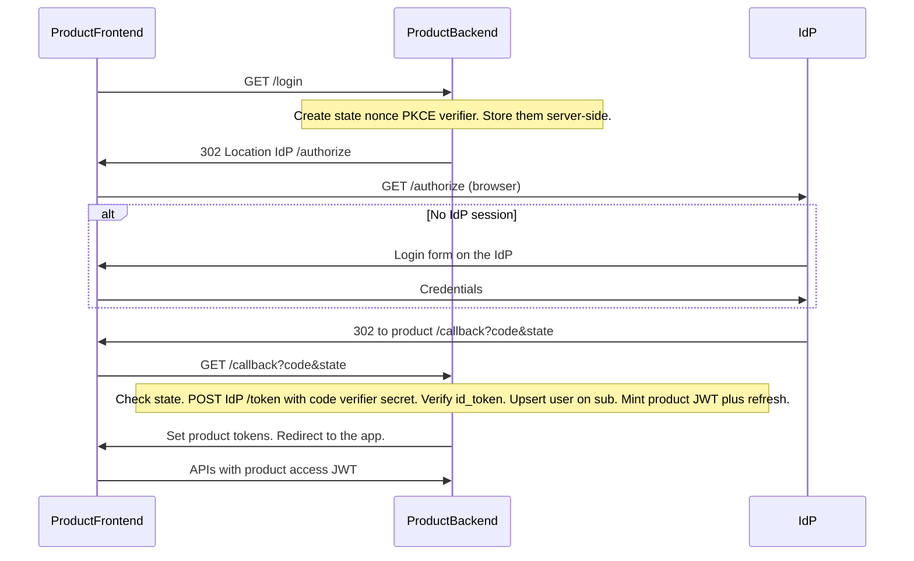

# Integrating a product with sc-idp

This IdP is a **confidential-client** OpenID Connect provider. Your **product backend** is the OAuth client. The product **frontend never talks to the IdP as an API** and **never sees IdP tokens**.

You do **not** build a login, register, or MFA form. Those pages live on the IdP. Your UI only has “Sign in” / “Sign out” and then calls **your** APIs with **your** tokens.

Working reference: [`demo/product.py`](../demo/product.py).

---

## Who does what

| Actor | Owns |
| --- | --- |
| **IdP** | Login, register, MFA, consent, IdP session cookie, `/authorize`, `/token`, `/userinfo`, `/logout` |
| **Product backend** | OAuth client (`client_id` + `client_secret`), PKCE verifier, code exchange, ID-token verify, user upsert on `sub`, product JWT + product refresh, all API authorization |
| **Product frontend** | “Sign in” that hits **your** backend, follow redirects, send **product** access JWT on API calls, call **your** `/refresh` when that JWT expires, “Sign out” that hits **your** backend |

| Never in the browser | May be in the browser |
| --- | --- |
| `client_secret` | Product access JWT |
| IdP access token, ID token, IdP refresh | Product refresh (cookie or equivalent; not localStorage if you can avoid it) |
| PKCE `code_verifier`, OAuth `state`, `nonce` (keep them on the backend / HttpOnly cookie) | |

The frontend never calls `{issuer}/token`, never fetches JWKS to verify IdP tokens, and never sends `Authorization` to the IdP.

---

## Login flow (actors)



Silent SSO: if the user already logged in via another product, the IdP skips the form and returns a code immediately. Your backend still exchanges that code and mints **this** product’s JWT pair (different issuer and keys).

---

## Product endpoints you implement

These are **your** routes, not the IdP’s. Names can differ; the jobs cannot.

| Method | Route (demo) | Layer | Job |
| --- | --- | --- | --- |
| GET | `/login` | Backend, then browser redirect | Build `/authorize` URL (PKCE S256, `state`, `nonce`). Persist verifier/`state`/`nonce`. 302 the browser to the IdP. |
| GET | `/callback` | Backend | Must be the **exact** registered `redirect_uri`. Validate `state`. `POST` IdP `/token`. Verify ID token. Upsert on `sub`. Mint product JWT + refresh. Give those to the client. |
| GET/POST | `/refresh` | Backend | Rotate **product** refresh. Mint a new product access JWT. **Do not** call the IdP. |
| * | `/api/…` | Backend | Authorize with the **product** JWT (or a server session derived from it). Roles live here. |
| GET | `/logout` | Backend | Revoke product refresh family, clear product cookies. Optionally 302 the browser to IdP `/logout`. |

Frontend wiring:

1. Sign-in button → navigation (or redirect) to **your** `/login`, not to the IdP.
2. After callback, the user is on your origin with product tokens.
3. API calls: `Authorization: Bearer <product access JWT>` **or** the HttpOnly cookie your backend set.
4. HTTP 401 because the access JWT expired → `POST` **your** `/refresh`. If that fails, send them through `/login` again (silent if the IdP session is still alive).
5. Sign-out button → **your** `/logout`.

---

## SPA vs cookie BFF

Same OIDC rules. Different delivery of **product** tokens.

**Cookie BFF** (the demo): backend sets `HttpOnly` cookies for product access + product refresh. The SPA does not read tokens. CSRF on cookie-authenticated POSTs is your problem (`SameSite=Lax` is enough for top-level OIDC redirects).

**SPA + API**: backend’s `/callback` returns the product JWT pair in the JSON body (or sets only the refresh as HttpOnly on the API origin). The SPA sends the access JWT as `Bearer`. Store the refresh in an HttpOnly cookie on the API host if you can; avoid `localStorage` for refresh tokens.

Do not put IdP tokens in either model.

A public SPA **must not** be the OAuth client. There is no public-client / PKCE-only mode here: `/token` requires `client_secret`, which stays on the backend.

---

## One-time: register the client

Ops / backend. Not a frontend task.

```http
POST {issuer}/admin/clients
Authorization: Bearer <IDP_ADMIN_API_KEY>
Content-Type: application/json

{
  "name": "App A",
  "redirect_uris": ["https://appa.example/callback"],
  "post_logout_redirect_uris": ["https://appa.example/"],
  "allowed_scopes": ["openid", "email"],
  "is_first_party": true
}
```

`client_secret` is returned **once**. Store it in the product backend. `redirect_uris` are exact string matches (scheme, host, port, path, no slash normalization). First-party clients skip consent.

Discovery (backend, cache it):

```http
GET {issuer}/.well-known/openid-configuration
GET {issuer}/.well-known/jwks.json
```

Metadata only advertises `response_type=code`, PKCE `S256`, `RS256`, grants `authorization_code` and `refresh_token`. Implicit, hybrid, or PKCE `plain` will fail.

---

## Backend: start OIDC (`GET` your `/login`)

Redirect the **browser** to `{authorization_endpoint}` with:

| Param | Required |
| --- | --- |
| `client_id` | yes |
| `redirect_uri` | yes, exact registered string |
| `response_type` | `code` |
| `scope` | must include `openid`; add `email` if you want email on the ID token / userinfo |
| `code_challenge` | S256 of a 43–128 char verifier you generated |
| `code_challenge_method` | `S256` |
| `state` | yes in practice; CSRF for the redirect |
| `nonce` | recommended; must match the ID token |
| `prompt` | optional: `none` / `login` / `consent` |
| `max_age` | optional; seconds; forces re-auth if the IdP session is older |

PKCE (backend):

```python
import base64, hashlib, secrets
verifier = secrets.token_urlsafe(64)
challenge = base64.urlsafe_b64encode(hashlib.sha256(verifier.encode()).digest()).rstrip(b"=").decode()
```

Keep `verifier`, `state`, and `nonce` until `/callback` (server session or signed HttpOnly cookie). `prompt=none` returns `error=login_required` on the redirect URI instead of a login form.

Any OIDC library that speaks authorization-code + PKCE S256 as a **confidential** client is fine. The demo uses Authlib’s `AsyncOAuth2Client`. Generate the verifier yourself and pass it into `create_authorization_url`; Authlib does not store `client.code_verifier`.

---

## Backend: code exchange (`GET` your `/callback`)

Browser hits your `redirect_uri` with `code` and `state`. Your backend:

1. Reject if `state` does not match what you stored.
2. `POST {token_endpoint}` — **server to server**:

```http
POST {token_endpoint}
Authorization: Basic base64(urlencode(client_id):urlencode(client_secret))
Content-Type: application/x-www-form-urlencoded

grant_type=authorization_code&code=...&redirect_uri=...&code_verifier=...
```

`redirect_uri` must be the same string as at `/authorize`. `client_secret_post` is also accepted.

3. Keep the JSON on the server (`access_token`, `id_token`, `refresh_token`). None of it goes to the browser.

4. Verify the **ID token** with JWKS (cache keys; retiring `kid`s stay in JWKS during rotation):
   - RS256, `iss` = issuer with no trailing-slash mismatch, `aud` = your `client_id`, `exp`
   - `nonce` matches what you stored
   - no `role` / `roles` / permissions — if present, reject; this IdP will not mint them

5. `sub` is the stable user id. Upsert your user on `sub`. Optional: `GET {userinfo_endpoint}` with `Authorization: Bearer <IdP access>` for `email` / `email_verified` when scoped.

6. Mint **product** tokens (next section) and finish the browser request.

Store the **IdP refresh** in your DB keyed by user (and client), not in a cookie. You only need it later if *your backend* wants a fresh IdP access token (userinfo, `email_verified`). Most products can ignore it until then.

---

## Backend: mint product tokens

```text
IdP ID token  -->  backend reads sub
               -->  backend signs its own JWT (different iss, different keys)
               -->  backend stores a hashed rotating refresh in the product DB
               -->  browser receives product JWT + product refresh only
```

Product JWT may include roles. Still enforce anything that must be immediate on the server.

When the product access JWT expires, the frontend calls **your** `/refresh`. That handler must not talk to the IdP. Restart OIDC (`/login` → `/authorize`) only when **your** product refresh is dead or reuse was detected. If the IdP session cookie is still valid, that restart is silent.

Hash product refresh tokens with a deterministic keyed hash (HMAC), not Argon2 — Argon2 is not lookup-friendly.

---

## Two refresh clocks

| Clock | Who calls | When |
| --- | --- | --- |
| Product refresh | Frontend → product `/refresh` | Product access JWT expired; user should stay in the app |
| IdP refresh | Product backend → IdP `/token` | Backend still needs an IdP access token |

They are independent. Product tokens outliving IdP tokens is expected. Reuse of a spent IdP refresh revokes that client’s IdP family. Reuse of a spent product refresh should revoke **that product’s** family only.

---

## Logout is not global

Your `/logout`:

1. Revoke the product refresh family and clear product cookies / SPA tokens.
2. Optionally redirect the browser to `{issuer}/logout?id_token_hint=...&post_logout_redirect_uri=...` so the **IdP session** dies and the next product will not silent-SSO.

Skipping step 2 is normal SSO (sign out of this app, stay signed in at the IdP). It is not “log out of everything.”

IdP `/logout` cannot revoke product JWTs already issued, product refresh rows, or IdP access JWTs already sitting on backends. `post_logout_redirect_uri` must match a registered URI exactly; `id_token_hint` identifies the client. Unvalidated redirects are ignored; the IdP session is still cleared.

---

## MFA

If the user enabled TOTP, the IdP steps up at `/login/mfa` before issuing a code. `amr` on the ID token includes `otp`. Recovery codes are single-use. Products do not show a second authenticator prompt unless they want step-up for **their** sensitive actions.

---

## Common mistakes

- Building `/authorize` or calling `/token` from the SPA.
- Putting `client_secret` or IdP refresh in the frontend.
- Shipping IdP tokens to the browser “just for the session.”
- Putting roles, plan, or tenant on the IdP token.
- Redirecting to the IdP because the **product** access JWT expired. Call product `/refresh`.
- Treating IdP logout as a kill switch for product sessions.
- Fuzzy `redirect_uri` (http vs https, trailing slash, extra query).
- PKCE `plain`, or skipping PKCE because the client is confidential.
- Storing refresh tokens with Argon2, then scanning the table to verify.
- Using a public OIDC SPA library against this IdP as if it were Auth0’s SPA mode.
