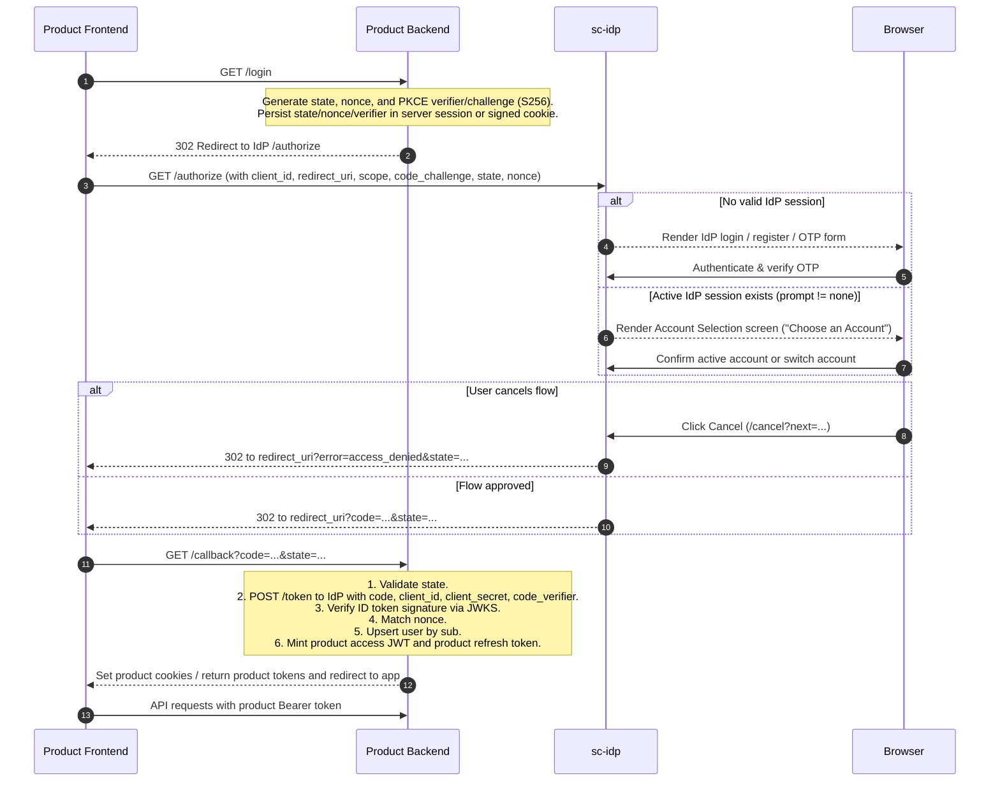

# Integrating a Product with sc-idp

Related docs: [IdP Technical Reference](idp-reference.md) · [Authentication & User Flows](flows.md) · [Admin Guide](admin-guide.md) · [Architecture](architecture.md) · [Security](security.md)

`sc-idp` is a **confidential-client** OpenID Connect (OIDC) provider. Your **product backend** is the OAuth client. The product **frontend never talks directly to the IdP as an API** and **never handles IdP tokens**.

You do **not** build login, registration, password reset, or MFA forms. Those interactions live exclusively on the IdP. Your UI only triggers "Sign in" / "Sign out" navigations and then calls **your** APIs using **your own** product tokens.

> [!IMPORTANT]
> ### First-Party Single Source of Truth Notice
> All **first-party Short Circuit applications** (such as `sc-admin`, internal dashboards, and core services) **must** treat `sc-idp` as the canonical single source of truth for user profile identity (`sub`, `email`, `given_name`, `family_name`, `name`, `idp_roles`).
> First-party products must not prompt users to re-enter standard identity fields or create redundant user profile editors. Products should only collect product-specific domain metadata (e.g., workspace configurations, organization settings, preferences).
> In contrast, **third-party applications** are granted full autonomy: they may choose whether to request `profile`/`email` scopes and whether to synchronize profile data or manage their own internal identity records.

---

## 1. Responsibilities by Layer

| Actor | Owns |
| --- | --- |
| **IdP** | Login, registration, 6-digit email OTP verification, password reset, MFA, consent, IdP session cookie, `/authorize`, `/cancel`, `/token`, `/userinfo`, `/logout` |
| **Product backend** | OAuth client credentials (`client_id` + `client_secret`), PKCE verifier, code exchange, ID-token validation via JWKS, user upsert on `sub`, product JWT + product refresh token minting, all API authorization |
| **Product frontend** | "Sign in" navigation hitting your backend, following HTTP redirects, passing product access JWTs on API calls, calling your backend `/refresh`, "Sign out" navigation |

### Boundary Security

| Never in the Browser | Handled by Browser |
| --- | --- |
| `client_secret` | Product access JWT (in memory or authorization header) |
| IdP access token, ID token, IdP refresh token | Product refresh token (HttpOnly cookie recommended) |
| PKCE `code_verifier`, OAuth `state`, `nonce` | Browser redirects between product and IdP |

The frontend never calls `{issuer}/token`, never fetches JWKS to verify IdP tokens, and never sends `Authorization` headers to the IdP.

---

## 2. Authentication Flow



---

## 3. Scopes & Identity Claims

Request scopes space-delimited in `scope`:

| Scope | Required | Claims Returned in ID Token & UserInfo | Purpose |
| --- | --- | --- | --- |
| `openid` | **Yes** | `sub`, `iss`, `aud`, `exp`, `iat`, `auth_time`, `amr`, `at_hash`, `nonce` | Standard OpenID Connect identity |
| `email` | Optional | `email`, `email_verified` | Verified user email address |
| `profile` | Optional | `given_name`, `family_name`, `name` | User name collected during registration |
| `idp_roles` | Optional | `idp_roles` (list of strings, e.g. `["admin", "sc_member"]`) | Global company/platform roles |
| `offline_access` | Optional | *None (triggers `refresh_token` issuance)* | Requests an IdP refresh token for ongoing background session synchronization and live profile updates. If omitted, the IdP issues no refresh token and the product operates with independent sessions. |

### Two-Tier Role Architecture
- **IdP Roles (`idp_roles`)**: Represent high-level identity tier and platform membership claims (e.g. `admin`, `sc_member`).
- **Product Permissions**: Fine-grained resources, workspace permissions (e.g., `workspace:write`, `editor`, `billing_admin`), and tenant associations must remain strictly inside the product backend. Products can map `idp_roles` to internal permission presets upon user upsert.

---

## 4. Endpoints Implemented by Your Product Backend

| Method | Route | Purpose |
| --- | --- | --- |
| `GET` | `/login` | Generate PKCE `code_verifier` (43–128 characters) and `code_challenge = BASE64URL(SHA256(verifier))`. Save `code_verifier`, `state`, and `nonce` in an encrypted or signed HttpOnly session cookie. 302 redirect browser to IdP `/authorize`. Include `offline_access` in `scope` if your product synchronizes with the IdP. |
| `GET` | `/callback` | Must be the **exact** registered `redirect_uri`. Handle errors (`error=access_denied`). Verify `state`. Make a server-to-server POST to IdP `/token`. Validate the ID token with JWKS. Upsert user on `sub`. Mint product tokens. If `offline_access` was requested, store the IdP refresh token. |
| `POST` | `/refresh` | Rotate the product refresh token. If using Pattern A (IdP-Synchronized), also call IdP `POST /token` (`grant_type=refresh_token`) to sync user info and check revocations. If using Pattern B (Decoupled), rotate internal product tokens locally without contacting the IdP. |
| `GET` | `/logout` | Invalidate product refresh token, clear product cookies. Optionally 302 redirect browser to IdP `/logout`. |

---

## 5. Protocol Wire Contracts

### 1. Authorize (`GET /authorize`)

Redirect the browser from your backend `/login` to:

```http
GET {issuer}/authorize?
  client_id=your_client_id
  &redirect_uri=https%3A%2F%2Fapp.example.com%2Fcallback
  &response_type=code
  &scope=openid+email+profile+idp_roles
  &code_challenge=E9Melhoa2OwvFrGMTJguCH5rtx64ZWqiJ61Z35NYF88
  &code_challenge_method=S256
  &state=c2VjdXJlX3JhbmRvbV9zdGF0ZQ
  &nonce=c2VjdXJlX25vbmNl
```

#### Query Parameters
- `client_id` (string, required): Registered client identifier.
- `redirect_uri` (string, required): Must match a registered URI exactly (scheme, host, port, path).
- `response_type` (string, required): Must be `code`.
- `scope` (string, required): Must include `openid`.
- `code_challenge` (string, required): S256 digest of PKCE verifier (`plain` is rejected).
- `code_challenge_method` (string, required): Must be `S256`.
- `state` (string, required in practice): CSRF token validated by your callback handler.
- `nonce` (string, recommended): Cryptographic binding echoed in the ID token.
- `prompt` (string, optional): Space-delimited prompt instructions (`none`, `login`, `consent`):
  - `none`: Enforces silent SSO. Never displays an account chooser, login form, or consent UI; immediately returns an error (`login_required`, `consent_required`) if interaction is needed.
  - `login`: Forces End-User re-authentication, ignoring any existing session cookie.
  - `consent`: Forces display of the permissions consent screen before returning an authorization code.
  - *(Default)*: When `prompt` is omitted and an active session exists, the IdP presents an interactive **Account Selection** screen ("Choose an Account") allowing the user to confirm their identity or switch accounts.
- `max_age` (integer, optional): Forces re-authentication if the IdP session is older than `max_age` seconds.

#### Error Redirection & Cancellation
If the user cancels or authorization fails, the browser is redirected to:
```http
GET https://app.example.com/callback?error=access_denied&state=c2VjdXJlX3JhbmRvbV9zdGF0ZQ
```

---

### 2. Code Exchange (`POST /token`)

Performed **server-to-server** from your product backend:

```http
POST {issuer}/token
Authorization: Basic <BASE64(client_id:client_secret)>
Content-Type: application/x-www-form-urlencoded

grant_type=authorization_code
&code=SplxlOBeZQQYbYS6WxSbIA
&redirect_uri=https%3A%2F%2Fapp.example.com%2Fcallback
&code_verifier=dBjftJeZ4CVP-mB92K27uhbUJU1p1r_wW1gFWFOEjXk
```

*(Alternatively, send `client_id` and `client_secret` in the URL-encoded body).*

#### Response (200 OK)
```json
{
  "access_token": "eyJhbGciOiJSUzI1NiIsImtpZCI6...",
  "token_type": "Bearer",
  "expires_in": 900,
  "refresh_token": "random_idp_refresh_token_string",
  "id_token": "eyJhbGciOiJSUzI1NiIsImtpZCI6...",
  "scope": "openid email profile idp_roles"
}
```

#### Verifying the ID Token
Using keys cached from `GET {issuer}/.well-known/jwks.json`:
1. Signature algorithm must be `RS256`.
2. `iss` must exactly match `{issuer}` (no trailing slash).
3. `aud` must match your `client_id`.
4. `exp` must be in the future.
5. `nonce` must match the value you provided at `/authorize`.
6. Read `sub` as the unique user identifier.

---

### 3. UserInfo (`GET /userinfo`)

Optional server-to-server call using the IdP access token:

```http
GET {issuer}/userinfo
Authorization: Bearer <IdP_access_token>
```

#### Response (200 OK)
```json
{
  "sub": "550e8400-e29b-41d4-a716-446655440000",
  "email": "user@shortcircuitcompany.com",
  "email_verified": true,
  "given_name": "Jane",
  "family_name": "Doe",
  "name": "Jane Doe",
  "idp_roles": ["sc_member"]
}
```

---

### 4. RP-Initiated Logout (`GET /logout`)

To terminate the IdP browser session when logging out of the product:

```http
GET {issuer}/logout?
  id_token_hint=<id_token>
  &post_logout_redirect_uri=https%3A%2F%2Fapp.example.com%2F
```

- `id_token_hint`: The ID token previously issued to the client.
- `post_logout_redirect_uri`: Must match a registered `post_logout_redirect_uris` entry for that client.
- If validated, the IdP revokes the session cookie and 302 redirects back to `post_logout_redirect_uri`.

---

## 6. Dual Refresh & Session Architecture

Products integrating with `sc-idp` choose between two session synchronization models:

```
+----------------------------------------------------------------------------------------------------+
| Model A: IdP-Synchronized Sessions (Continuous Live State)                                         |
| - Scope requested: openid email profile offline_access                                             |
| - On client /refresh: Client backend calls IdP POST /token (grant_type=refresh_token)               |
| - Benefits: Immediate profile/name sync, live idp_roles updates, instant response to IdP revocation |
+----------------------------------------------------------------------------------------------------+

+----------------------------------------------------------------------------------------------------+
| Model B: Decoupled Product Sessions (Independent Local Clocks)                                     |
| - Scope requested: openid email profile (no offline_access)                                         |
| - On client /refresh: Client backend rotates internal product tokens locally without contacting IdP|
| - Benefits: Complete network resilience, zero load on IdP during daily product API interactions    |
+----------------------------------------------------------------------------------------------------+
```

### Pattern A: IdP-Synchronized Sessions

Use this pattern when your application requires continuous alignment with user profile updates or immediate termination if access is revoked in `sc-idp`:

1. **Authorization Code Request**: Include `offline_access` in the requested `scope` at `GET /authorize`.
2. **Token Storage**: Save the returned IdP `refresh_token` in your product database (e.g., `accounts.refresh_token`).
3. **Product Refresh Handler (`POST /refresh`)**:
   - Call `sc-idp` `POST /token` with `grant_type=refresh_token`, your client credentials, and the stored `refresh_token`.
   - **Scope Downscoping / Optimization**: If you do not require profile updates on every refresh, pass `scope="openid email offline_access"` (omitting `profile`). The IdP will omit `name`, `given_name`, and `family_name` from the newly minted `id_token`.
   - **User Profile Sync**: Verify the new `id_token` with JWKS, extract updated claims, and update your local database record.
   - **Revocation Handling**: If `sc-idp` returns `400 invalid_grant` (due to user deactivation, session revocation from the IdP Account Center, or token expiration), clear product cookies and return `401 Unauthorized`.
   - **Network Resilience Fallback**: If `sc-idp` is unreachable or times out, log a warning and fall back to local cached user data, maintaining user continuity until the IdP is reachable.

### Pattern B: Decoupled Product Sessions

Use this pattern when you want zero external network dependencies for active user sessions:

1. **Authorization Code Request**: Omit `offline_access` from `scope`.
2. **Token Response**: `sc-idp` returns `access_token` and `id_token`, but **no `refresh_token`**.
3. **Product Refresh Handler (`POST /refresh`)**:
   - The product rotates its own internal refresh tokens and access JWTs locally.
   - The IdP is contacted only on initial login or when the product session completely expires and the user re-authenticates via `/authorize`.

---

## 7. Connected Applications & Self-Service Revocation

Users can view and manage all applications authorized to access their identity from the **Account Center** (`/account?tab=apps`).

- **Application Listing**: Displays application name, type (First Party vs Third Party), authorized timestamp, last active timestamp, and active status.
- **Single Revocation**: Users can click "Revoke Access" to terminate sessions for a specific application.
- **Revoke All**: Users can click "Revoke All Applications" to immediately invalidate all client refresh tokens across all products.
- **Client Impact**: For clients implementing **Pattern A**, the next time their backend calls `POST /token` (`grant_type=refresh_token`), the IdP rejects the call with `invalid_grant`, terminating the client session.

---

## 8. Common Integration Mistakes

1. **SPA directly calling `/token`**: Public clients cannot protect `client_secret`. The backend must exchange the code.
2. **Leaking IdP tokens to the browser**: The browser only receives product tokens.
3. **Misconfigured redirect URIs**: Missing port, wrong scheme (http vs https), or mismatched trailing slashes cause immediate rejection at `/authorize`.
4. **Skipping PKCE**: `sc-idp` strictly requires PKCE `S256` for confidential clients.
5. **Missing `offline_access`**: If you expect an IdP refresh token for ongoing synchronization, you must include `offline_access` in the `scope` parameter.
