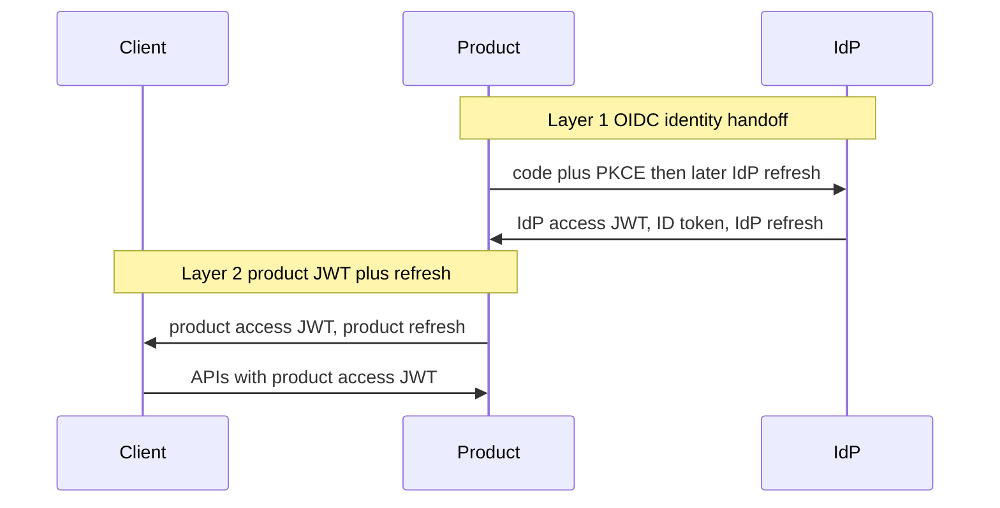

# sc-idp

Central **OpenID Connect** identity provider. One login for every product, on every domain.

The IdP answers **who the person is**. Each product answers **what they can do** and **whether they are paying**.

This is the implementation spec. Product teams should start at [docs/integrating-a-product.md](docs/integrating-a-product.md). Architecture, threat model, and operations live under `docs/`.

## Locked in

- **B2C** — no organizations, memberships, or org-scoped roles. Everything keys off `user_id` (`sub`).
- **Roll our own IdP** — OIDC, sessions, tokens, MFA, and the security edge cases live in this repo. No Keycloak / Ory / Auth0 / Clerk.
- **IdP tokens are identity only.** Access and ID tokens may include `sub`, email, and similar. They must not include product roles, permissions, or billing. Enforced by a claim allowlist at mint time.
- **IdP tokens stay on the product backend.** The browser never gets IdP access or refresh tokens.
- **Product → client is JWT + refresh, not a session id.** After the OIDC code exchange, the product mints its **own** short-lived access JWT and a rotating refresh token.

## Stack

FastAPI + Postgres (SQLAlchemy 2 async, Alembic, `psycopg` 3). RS256 via `joserfc`. Passwords: Argon2id. High-entropy secrets (codes, refresh, session, client secret): HMAC-SHA256 with a server pepper so they are indexable. TOTP: `pyotp`, secret encrypted at rest.

The two OIDC grants (`authorization_code`+PKCE, `refresh_token`) are hand-rolled. Authlib has no async/Starlette **provider**. Demo products use Authlib as a **client** so a standard library is proven against this IdP.

## Pattern

Centralized AuthN, decentralized AuthZ. Two JWT/refresh pairs. Independent clocks: product tokens outliving IdP tokens is expected.

Do not send the user to the IdP merely because the product access JWT expired. Hit the **product** `/refresh`. Restart OIDC only when the **product** refresh is dead.

## Corrections from the original sketch

- **Argon2 is for passwords only.** Auth codes, refresh tokens, session tokens, and client secrets are high-entropy random values. Argon2 salts randomly (`hash(x) != hash(x)`), so you cannot look them up. They are stored as `HMAC-SHA256(pepper, token)`.
- **IdP session cookie is `SameSite=Lax`.** `/authorize` is a top-level GET. `None` would only be needed for iframe silent SSO, which we do not build.
- **MFA ships with hashed recovery codes.** Enabling TOTP without a recovery path is a lockout footgun.

## Schema (Postgres)

`users`, `oauth_clients`, `authorization_codes` (row survives consumption so replay can revoke the family it issued), `refresh_tokens` (`family_id`, rotate on use, reuse revokes the family), `auth_sessions`, `signing_keys` (active + retiring overlap), `email_tokens`, `audit_events`, `rate_limits`, `mfa_recovery_codes`.

Not in the IdP: product JWTs, product refresh tables, product roles, permissions, billing, OPA.

## OIDC surface

| Method | Path | Notes |
| --- | --- | --- |
| GET | `/.well-known/openid-configuration` | Advertises `code`, `RS256`, `S256` only |
| GET | `/.well-known/jwks.json` | Public halves, including retiring keys |
| GET | `/authorize` | Client + exact `redirect_uri` **before** any redirect; PKCE S256 required |
| POST | `/token` | `authorization_code` and `refresh_token` |
| GET | `/userinfo` | Bearer IdP access token |
| GET | `/logout` | RP-initiated; exact `post_logout_redirect_uri` |
| GET/POST | `/register` `/login` `/forgot-password` `/reset-password` | Account + IdP session |
| GET/POST | `/account/mfa` `/login/mfa` | TOTP + recovery codes |
| POST | `/admin/clients` | Returns `client_secret` once. Bearer admin API key |
| POST | `/admin/keys/rotate` | Overlap rotation |

Consent is shown only when `is_first_party` is false (or `prompt=consent`).

## Security rules

- PKCE S256 on every authorization code. `plain` is rejected. Discovery does not advertise it.
- `redirect_uri` exact string match. Unknown client or unknown URI → HTML error, **never** a redirect.
- Refresh rotation + family revocation on reuse. `SELECT … FOR UPDATE` so concurrent refresh is safe.
- Authorization code replay revokes the refresh family issued from that code.
- Passwords Argon2id; dummy verify on unknown user; identical error text; lockout after N failures still returns that text.
- Session cookie: `HttpOnly`, `Secure` (configurable), `SameSite=Lax`. New session token on login and on MFA step-up (session fixation).
- CSRF: signed double-submit cookie + hidden field on every HTML form.
- Rate limit login, register, and token (Postgres fixed window).
- Identity-only claim allowlist on mint. A product `role` on an IdP token is a crash, not a regression in a year.

## Default TTLs (override via env)

| Thing | Default |
| --- | --- |
| Authorization code | 60s, single use |
| IdP access / ID JWT | 15 min |
| IdP refresh | 30d sliding, 90d absolute family cap |
| IdP browser session | 12h idle, 7d absolute |
| Demo product access JWT | 10 min |
| Demo product refresh | 30d |

## Out of scope

Organizations, OPA, billing/entitlements, product role models, iframe silent SSO, implicit/hybrid grants, dynamic client registration, real staff SSO for `/admin` (v1 is an API key; production should replace that).

## Runnable check

`python tests/test_flow.py` — register, PKCE round trip, JWKS verify, then: allowlist reject, code replay, refresh-family reuse, silent SSO, `prompt=none` after logout.
